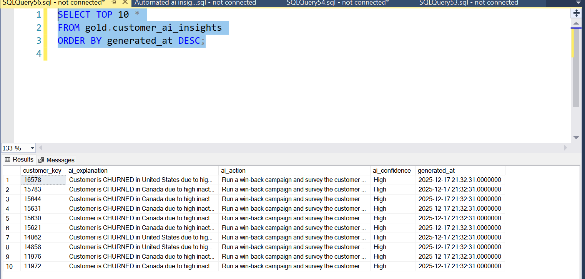

# Customer Churn Reduction | A/B Testing & Retention Analytics

A customer analytics and experimentation project that brings together CRM and ERP data to understand sales performance, identify inactive and at-risk customers, and evaluate retention strategies through controlled A/B testing.

The project combines a SQL Server data warehouse, SQL-based customer and sales analysis, Power BI dashboards, rule-based customer insights, and a Python-powered A/B testing workflow.

---

## Project Overview

Customer churn can reduce recurring revenue and limit long-term customer value. Businesses need a reliable way to understand customer purchase behaviour, spot inactivity early, and determine whether retention campaigns are actually improving customer outcomes.

This project addresses that challenge by creating a unified analytics workflow:

1. Integrate CRM and ERP source data into a SQL Server data warehouse.
2. Clean and standardize data through Bronze, Silver, and Gold layers.
3. Analyze customer, product, and sales performance using SQL.
4. Identify customers who may be inactive or at risk of churn.
5. Present customer and churn insights through Power BI dashboards.
6. Set up a retention-offer A/B testing workflow and evaluate retention and revenue differences statistically.

## Business Problem

Customer, product, and transaction information is often spread across separate operational systems. Without a consistent analytical view, teams may struggle to answer questions such as:

- Which customers and customer segments contribute the most revenue?
- Which products and categories drive sales?
- Which customers have not purchased recently?
- How does inactivity relate to customer value and engagement?
- Does a retention offer improve 30-day purchase behaviour compared with a control group?
- Is the observed difference in retention or revenue statistically significant?

**Objective:** Turn customer and sales data into practical retention insights, and provide a measurable framework for evaluating customer win-back initiatives.

## Solution Architecture

The data warehouse follows a Medallion Architecture.

| Layer | Purpose | Main activities |
|---|---|---|
| **Bronze** | Raw data ingestion | Load CRM and ERP CSV extracts into source-aligned SQL Server tables. |
| **Silver** | Data cleaning and standardization | Handle duplicates, trim text, normalize categorical values, validate dates, and standardize sales fields. |
| **Gold** | Business-ready analytics | Create customer and product dimensions, a sales fact view, and reporting/experimentation structures. |

The Gold layer uses a star-schema-style model with:
- `gold.dim_customers` – customer attributes enriched with available ERP information.
- `gold.dim_products` – product, category, and product-line attributes.
- `gold.fact_sales` – sales transactions connected to customer and product dimensions.

Architecture diagrams and documentation are available in [datawarehouse/docs/architecture](datawarehouse/docs/architecture/).

## Analytical Workstreams

### 1. Sales and Customer Analysis with SQL

The SQL analysis covers:

- Database and table exploration.
- Core business measures such as total sales, orders, customers, quantity sold, and average price.
- Customer and product dimension exploration.
- Sales and customer distribution by country and category.
- Revenue contribution and part-to-whole analysis.
- Product and customer ranking.
- Customer value segmentation.
- Monthly sales trends, cumulative sales, and moving averages.
- Year-over-year product performance comparisons.

SQL concepts used include joins, CTEs, aggregate functions, CASE expressions, date functions, subqueries, and window functions such as `RANK()`, `ROW_NUMBER()`, `LAG()`, and `SUM() OVER()`.

### 2. Customer Churn and Retention Analysis

The current SQL churn logic identifies a customer as churned/inactive when:

- The customer has never made a purchase, or
- The customer's most recent purchase was more than 90 days ago.

The analysis uses the latest order date per customer and compares it with the current date. This is a project-specific inactivity rule; a production business should calibrate the threshold to its normal purchase cycle and define an observation date consistently.

The dashboards are designed to help business users explore customer behaviour and churn patterns, and prioritize customers for retention outreach.

### 3. Customer Segmentation and AI-Assisted Insights

The project includes customer segmentation based on sales value and purchase history, alongside a deterministic, rule-based insight generator.

The Python insight script uses signals such as:
- Days since the customer's last purchase.
- Lifetime order count.
- Lifetime revenue.
- Current customer risk status.

It generates a plain-language explanation, a suggested retention action, and a confidence label for analyst review. Examples of suggested actions include personalized reactivation outreach, a time-limited offer for selected at-risk customers, and win-back communication for churned customers.

**Implementation note:** The current insight generator is rule-based. It does not train a machine-learning model or call an external generative AI service.

### 4. Retention Offer A/B Testing

The repository includes an experimentation workflow for customers classified as at risk.

| Group | Experience |
|---|---|
| **A – Control** | No retention offer / baseline experience. |
| **B – Treatment** | Receives a proposed retention offer or campaign communication. |

The workflow includes:

1. Create the experiment assignment and outcome tables.
2. Randomly assign eligible at-risk customers to Group A or Group B.
3. Capture or simulate 30-day purchase and revenue outcomes.
4. Validate group assignment and outcome records.
5. Compare retention and revenue between the two groups.
6. Review statistical significance before considering a rollout.

**Statistical methods implemented:**
- **Chi-square test:** compares the 30-day purchase/retention proportions between groups.
- **Welch's two-sample t-test:** compares average 30-day revenue between groups without assuming equal variances.
- **Relative retention lift:** calculates the percentage change in retention rate from Control to Treatment.

The main outcome fields are `purchase_within_30d` and `revenue_within_30d`.

#### Important: simulated versus real experiment data

The current `simulate_ab_outcomes.py` script generates illustrative outcomes using configurable probabilities (18% for Control and 24% for Treatment) and a configured revenue distribution. These values are simulation assumptions, not observed campaign performance.

Consequently, any p-values or lift calculated from those simulated records demonstrate how the analysis workflow operates; they should not be presented as evidence that a real retention campaign improved business performance. For a business decision, replace simulated outcomes with actual, consistently measured experiment data.

## Power BI Dashboards

The repository contains two Power BI reports:

- [Customer Behavior dashboard](dashboards/Customer%20Behavior%20dashboard.pbix)
- [Customer Churn dashboard](dashboards/Customer%20churn%20dashboard.pbix)

Dashboard previews:

**Customer Behavior**


**Customer Churn**


**Rule-based customer insight output**


Open the `.pbix` files with Power BI Desktop. A local SQL Server connection and the relevant data model may need to be configured before refreshing the reports.

## Key Business Metrics

| Metric | Definition / use |
|---|---|
| Total Sales | Sum of sales amount across transaction records. |
| Total Orders | Count of distinct sales orders. |
| Total Customers | Count of customers in the customer dimension or with purchases, depending on the measure definition. |
| Average Order Value (AOV) | Revenue divided by distinct orders, using a consistent order-level calculation. |
| Purchase Frequency | Number of orders per customer over a selected period. |
| Customer Lifetime Revenue | Cumulative sales amount attributed to a customer. |
| Days Since Last Purchase | Days between the analysis date and the customer's latest order date. |
| Churn / Inactivity Status | Customer status based on the defined inactivity rule. |
| 30-Day Retention Rate | Share of assigned customers with at least one purchase within 30 days. |
| Retention Lift | Relative difference in retention rate between Treatment and Control. |
| Average 30-Day Revenue | Average revenue per assigned customer during the 30-day outcome window. |

Metric definitions should be kept consistent across SQL, Python, and Power BI. For experimentation, analyze customers at the assignment level and avoid counting multiple transaction rows as multiple customers.

## Technology Stack

- **Database:** Microsoft SQL Server
- **Querying and transformation:** T-SQL
- **Data warehouse design:** Bronze–Silver–Gold / Medallion Architecture
- **Visualization:** Microsoft Power BI
- **Programming:** Python
- **Python libraries:** Pandas, NumPy, PyODBC, SciPy
- **Statistical analysis:** Chi-square test, Welch's t-test
- **Documentation and version control:** Markdown, Git, GitHub

## Repository Structure

```text
.
├── ab_testing/
│   ├── code/
│   │   ├── ab_significance.py
│   │   ├── pull_sql_data.py
│   │   └── simulate_ab_outcomes.py
│   ├── outcome/
│   │   └── ab_results.xlsx
│   └── sql/
│       ├── create_assignment_table.sql
│       ├── create_outcomes_table.sql
│       ├── random_assignment.sql
│       └── validate_assignment.sql
│
├── analytics/
│   ├── code directory/       # SQL exploration and analysis scripts
│   └── data directory/       # Bronze, Silver, and Gold CSV extracts
│
├── dashboards/
│   ├── Customer Behavior dashboard.pbix
│   ├── Customer churn dashboard.pbix
│   ├── ai_insights.py
│   ├── automated_ai_insights.sql
│   ├── upsert_ai_insights.py
│   └── screenshots/
│
├── datawarehouse/
│   ├── QA Tests/
│   ├── dataset/
│   │   ├── crm/
│   │   └── erp/
│   ├── docs/
│   │   └── architecture/
│   └── scripts/
│       ├── bronze/
│       ├── silver/
│       └── gold/
│
└── README.md
```

## Getting Started

### Prerequisites

- Microsoft SQL Server.
- SQL Server Management Studio (SSMS) or another SQL client.
- Python 3.9 or later.
- Microsoft ODBC Driver for SQL Server.
- Power BI Desktop (for opening and refreshing the dashboards).

### 1. Clone the repository

```bash
git clone https://github.com/tamil1208/-Customer-Churn-Reduction---A-B-Testing---Retention-Analytics.git
cd -Customer-Churn-Reduction---A-B-Testing---Retention-Analytics
```

### 2. Prepare the data warehouse

Review the SQL scripts under `datawarehouse/scripts/` and execute them in the appropriate order for your SQL Server environment:

1. `init_database.sql` – creates the warehouse database and schemas.
2. `bronze/ddl_bronze.sql` – creates Bronze tables.
3. `bronze/proc_load_bronze.sql` – creates the Bronze loading procedure.
4. `silver/ddl_silver.sql` – creates Silver tables.
5. `silver/proc_load_silver.sql` – creates the Silver transformation procedure.
6. `gold/ddl_gold.sql` – creates Gold dimension and fact views.

After configuring the source-file locations, run the Bronze and Silver loading procedures, then create the Gold views and execute the quality checks in `datawarehouse/QA Tests/`.

> **Database safety and configuration:** `init_database.sql` drops and recreates the `DataWarehouse` database if it already exists. Run it only in a disposable development environment after backing up any data you need. The current bulk-load procedure also contains machine-specific Windows file paths, and the A/B Python scripts contain a local SQL Server instance/database configuration. Update these values for your environment before running the scripts. Check the ERP customer table naming in the Bronze loader against the Bronze DDL before execution.

### 3. Install Python dependencies

```bash
pip install pandas numpy scipy pyodbc
```

Install and configure the Microsoft ODBC Driver separately. Update the server, database, and authentication settings in the Python scripts to match your SQL Server setup.

### 4. Run the A/B testing workflow

After the Gold churn-status view and required schemas/tables are available:

1. Execute `ab_testing/sql/create_assignment_table.sql`.
2. Execute `ab_testing/sql/create_outcomes_table.sql`.
3. Execute `ab_testing/sql/random_assignment.sql` to assign eligible at-risk customers.
4. Run `ab_testing/code/simulate_ab_outcomes.py` for demonstration data, or load actual 30-day experiment outcomes.
5. Execute `ab_testing/sql/validate_assignment.sql`.
6. Run `ab_testing/code/ab_significance.py` to calculate retention lift and statistical test results.

The current A/B scripts use the `DataWarehouseAnalytics` database name, while the warehouse bootstrap script creates `DataWarehouse`. Align the database names and ensure the required `gold.v_customer_churn_status` view exists before executing the A/B workflow.

### 5. Open the dashboards

Open the Power BI files in `dashboards/` using Power BI Desktop. Configure the data source and refresh the model using your local Gold-layer views/tables.

## Data Quality and Validation

SQL validation scripts are included for Silver and Gold layers.

Checks cover:
- Duplicate or null customer and product identifiers.
- Unwanted whitespace and inconsistent categorical values.
- Invalid product costs and date ranges.
- Invalid sales dates and inconsistent sales, quantity, and price values.
- Referential integrity between sales facts and customer/product dimensions.
- Uniqueness of Gold dimension surrogate keys.

A/B assignment validation checks group sizes, assignment balance, purchase flags, revenue values, and outcome timestamps.

## Future Enhancements

- Replace simulated A/B results with outcomes from a real retention campaign.
- Add experiment guardrails, sample-size planning, pre-defined hypotheses, and a fixed measurement window.
- Add confidence intervals and effect-size reporting alongside p-values.
- Improve churn thresholds using customer purchase-cycle patterns.
- Add cohort and repeat-purchase analysis.
- Build a dedicated retention dashboard with campaign, customer segment, and incremental revenue views.
- Extend the rule-based insights with validated predictive models and explainability.
- Automate refresh and monitoring after the data pipeline and environment configuration are standardized.

## Author

**Tamilarasan**

- GitHub: [tamil1208](https://github.com/tamil1208)

## License

This project is distributed under the [MIT License](LICENSE).
